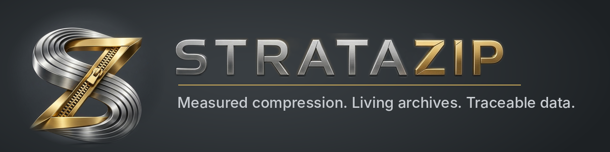

<p align="center">
  
</p>

<p align="center">
  <a href="LICENSE"></a>
  <a href="COMMERCIAL.md"></a>
  
</p>

**StrataZip.** Measured compression. Living archives. Traceable data.

Each block of your data is tried against several coders, and the one that measures smallest
on *that* block is kept. The archive keeps living: mounted, synced, locked and mended, with
every change a hashed commit you can sign and trace back, and every byte checked on the way
out.

```
$ stratazip -l 9 -c prices.csv prices.stz
$ stratazip -d prices.stz prices.csv
```

## What it's for

| The job | The commands |
|---|---|
| **Keep years of tables and logs small**, and take one file back out | `stratazip -l 9 -c logs logs.stz` · `--get logs.stz day-17.log out.log` |
| **A nightly backup** that mends a bad sector, shows it is unchanged since you signed it, and gives back last Tuesday | `-r 5 -c project backup.stz --sign-with me.key`, then nightly `--sync project backup.stz` · `--at <time> --get` |
| **An archive you use as a drive**, with one folder locked | `--mount office.stz ~/office --rw` · `--seal office.stz hr --lock hr -p` |
| **Two machines in step** through one archive, text edits merged | `--sync ~/notes ssh://host/shared.stz --two-way` |
| **Find things without unpacking**, or hand a language model the passages that answer | `-c docs docs.stz --index` · `--search "words" docs.stz --passages` |
| **When a disk goes bad** | `-v` · `--repair bad.stz mended.stz` · `--salvage bad.stz rescued.stz` |

Each one is walked through with real output in **[the guide](docs/GUIDE.md)**.

## Why StrataZip

- **It picks the coder per block, by measurement.** Text, code and tables go to a
  context-mixing model with forty contexts, among them one that knows where each byte
  stands in its line and field; 16-bit images to a picture coder that finds the width
  and byte order itself; 16-bit audio to a waveform coder; DNA to a two-bit coder that
  learns both strands. Nothing is guessed from a file name.
<!-- bench:readme-measured -->
- **Measured against zpaq, xz, 7-Zip and zstd.** On the Silesia corpus
  level 9 is 7.4% under zpaq's strongest mode and level 10 12.7% under, the smallest of every
  tool on all twelve files. On market data, 26.7% under zpaq; on sensor logs, 8.9%.
<!-- /bench:readme-measured -->
- **It sees inside ZIP, JAR, DOCX, gzip and PDF files.** Their deflate streams are
  unwrapped and compressed as what they hold, wherever the bundled zlib can rebuild them
  bit for bit on extraction; the rest are kept as they are.
- **Your data, verified.** A CRC-32 on every block and a SHA-256 on every file in a
  tree. A damaged archive is refused, never silently mis-decoded, and optional
  Reed-Solomon recovery records (`-r 5` for 5%) can repair it.
- **A folder compresses as well as its files, and files alike as one.** Pictures, tables,
  audio, DNA, code and data that will not shrink get blocks of their own; files that resemble
  each other (versions, snapshots, rotated logs) share blocks, and at levels 7 to 10 a run of
  them is one block of up to 64 MiB. The Silesia corpus archived as one folder is smaller than
  its twelve files archived one by one at levels 4 to 9; eight versions of a file take little
  more than one.
- **Directory trees, incrementally.** Archive a whole tree with permissions, times, links,
  and with `--same-owner` owners and hard links; identical files are stored once. Give it
  last night's archive (`--from`) and files that have not changed are not even read again.
- **An archive that changes in place, safely.** Mount it as a drive, sync a folder into it
  or both ways through it, seal parts of it under a password or a key: every change is a
  commit appended to the archive, and a crash costs only what was written since the last
  one. Damage is told from a crash (with recovery records or a signature, always): it is
  reported, nothing writes over it, and `--repair` or `--salvage` gets your files back.
- **Locks and signatures.** XChaCha20-Poly1305 locks opened and shut at will, even on a
  mounted archive; signatures by Ed25519 and ML-DSA-65 together, so forging one means
  breaking both. New in 1.2 and not yet reviewed outside the project: see
  [SECURITY.md](SECURITY.md) before you rely on them.
- **Search inside an archive.** An index of its words, kept current by every commit:
  `--search` ranks the files without decoding them, and `--search --passages` hands a
  language model the passages that answer, within a budget of words.
- **One file out of a big archive** (`--get`) decodes only the blocks that hold it, and
  **`--info`** shows what an archive is made of without decoding it (`--json` for tools).
- **Safe writes.** Output goes to a temporary name and is renamed into place only when
  it is complete.

## Benchmarks

One thread per tool, every tool on the same machine, and every result decompressed and
compared byte for byte (FLAC's on their audio samples). The Silesia numbers are reproducible with
[`bench/run.sh`](bench/run.sh) on public data. [docs/BENCHMARKS.md](docs/BENCHMARKS.md)
has the full tables, the machine, and the caveats.

<!-- bench:readme-research -->
The research compressors cmix and paq8px publish smaller results on these corpora; they
were not run here.
<!-- /bench:readme-research -->

### Structured data, genomes and text

<!-- bench:readme-struct -->
| Data | Size | xz -9e | zstd -19 | zpaq -m5 | **StrataZip&nbsp;-l&nbsp;9** | **StrataZip&nbsp;-l&nbsp;10** |
|---|---:|---:|---:|---:|---:|---:|
| Bitcoin price history, 2017 to 2025, CSV | 2,575,631 | 153,772 | 200,502 | 113,063 | 82,925 | **82,818** |
| Bike&Safe sensor logs (the dataset as a tar) | 47,544,320 | 15,109,452 | 15,663,947 | 11,540,076 | 10,516,775 | **10,222,204** |
| *E. coli* genome (Canterbury large corpus) | 4,638,690 | 1,186,180 | 1,148,133 | 1,114,234 | 1,099,133 | **1,096,355** |
| enwik8, 100 MB of Wikipedia | 100,000,000 | 24,831,648 | 26,954,633 | 19,625,015 | 19,953,846 | **18,700,345** |

On enwik8 zpaq -m5 beats level 9 by 1.6%; level 10, which sees the file in two blocks
rather than twenty-four, is 4.7% under it.
<!-- /bench:readme-struct -->

### Audio: smaller than FLAC

<!-- bench:readme-audio -->
| Recording (16-bit PCM) | Size | FLAC -8 | **StrataZip** | |
|---|---:|---:|---:|---:|
| Field recordings, ten ESC-50 clips | 4,410,078 | 1,880,800 | **1,784,415** | **−5.1%** |
| Pop song, 30 s (decoded from MP3) | 5,292,162 | 3,613,378 | **3,400,260** | **−5.9%** |
| Pop song, 30 s (decoded from MP3) | 5,292,184 | 3,095,882 | **2,874,306** | **−7.2%** |
<!-- /bench:readme-audio -->

The audio coder runs at every level; these are level 4. FLAC decodes much faster, so
StrataZip is for keeping audio, not for playing it.

### The Silesia corpus: general data

The standard corpus of mixed real data (12 files, 212 MB).

<!-- bench:readme-silesia -->
| Tool | Size (MB) | Ratio | Compress (MB/s) | Decompress (MB/s) |
|---|---:|---:|---:|---:|
| gzip -9 | 67.63 | 3.134 | 9.45 | 133.11 |
| **StrataZip -l 4** | 56.18 | 3.773 | 2.84 | 60.88 |
| bzip2 -9 | 54.51 | 3.888 | 11.38 | 26.77 |
| zstd -19 | 53.02 | 3.997 | 1.97 | 483.12 |
| **StrataZip -l 6** | 52.73 | 4.019 | 0.75 | 62.31 |
| zstd --ultra -22 --long=27 | 52.52 | 4.035 | 1.55 | 431.27 |
| brotli -q 11 -w 24 | 49.56 | 4.276 | 0.43 | 251.15 |
| 7z -mx=9 | 48.76 | 4.347 | 1.91 | 62.29 |
| xz -9e | 48.46 | 4.374 | 1.45 | 61.21 |
| bzip3 | 46.93 | 4.516 | 9.17 | 8.99 |
| zpaq -m5 | 39.11 | 5.419 | 0.39 | 0.38 |
| **StrataZip -l 9** | 36.23 | 5.850 | 0.08 | 0.10 |
| **StrataZip -l 10** | 34.16 | 6.205 | 0.06 | 0.10 |

Levels 9 and 10 are the smallest, and the slowest: zpaq -m5 compresses at 0.39 MB/s
here, StrataZip's level 9 at 0.08, on one thread.
<!-- /bench:readme-silesia -->

Two of the files (`mr`, `x-ray`) are
16-bit medical images, which StrataZip codes with its picture coder at every level, so
even level 4 makes them smaller than any other tool does. Per-file results are
in [docs/BENCHMARKS.md](docs/BENCHMARKS.md).

### Choosing a level

| Level | Use it for | Speed |
|---|---|---|
| `-l 1` to `-l 3` | quick archives, fast both ways | the fastest |
| `-l 4` (default) | everyday archives: about the size of `xz -6` | compresses about 10% slower than `xz -6`; decompresses at about 70 MB/s on one thread (Silesia but for its two images), 26 to 31 MB/s on literal-heavy binaries, as `xz` does |
| `-l 5`, `-l 6` | smaller on text and tables, still quicker to open than to make: a BWT coder or level 4's, whichever wins each block | slower to compress and to open than level 4 |
| `-l 7` to `-l 9` | the smallest files at a practical pace: context mixing | about as slow to decompress as to compress |
| `-l 10`, `-e` | the last bits: 64 MiB blocks, tables sized to the free memory | slower still; needs the same memory to decompress |

Levels 7 to 10 are symmetric, like zpaq and cmix: opening the archive takes about as long
as making it. Use them for archives you keep, not for files you open every day. Data that
is as dense as noise (archives, encrypted data) is stored as it is at levels 1 to 9;
`-F` codes it anyway.

## The format

StrataZip writes its own format, **`.stz`**, described byte by byte in
[docs/FORMAT.md](docs/FORMAT.md). It is not zip, 7z or tar, and other archivers will not
open it. That is the price of the ratio: none of the common formats can carry these
coders. Every archive StrataZip has ever written stays readable by every later version,
and the format has room to grow: StrataZip 1.2 opens the archives of later versions and
says exactly what, if anything, it cannot read. For an archive that must go to someone
still on StrataZip 1.1, `--format 9` writes 1.1's format at levels 1 to 3 (with no
journal, locks, sync or index).

## Working with archives

### An archive that changes

A folder archive can be changed in place: by a mounted drive, by `--sync`, by sealing or
indexing. Each change is a **commit** appended to the archive's journal and written to the
disk before it is acknowledged; the commit record is written twice, so one damaged copy
loses nothing. A crash leaves at most a **torn tail** (a write cut short before its
commit), which the next writer cuts; nothing acknowledged is lost. `--compact` folds the
journal back into a fresh archive.

**Damage is not a torn tail.** If a byte inside the journal is damaged, the commits after
it cannot be reached, and StrataZip says so rather than cutting them:

- `--info` shows the archive's state: whole, a torn tail, needs repair (something was read
  from its copy; nothing is lost), or damaged (with the byte and the commits out of reach).
- `-v` says NEEDS REPAIR (exit **3**) when the recovery records mend the damage (it mends it
  in memory and reads every commit through it; nothing is lost), and FAIL (exit **1**) when
  they cannot; every other command reads the tree it can reach, warns, and exits **3**.
- No command writes to a damaged archive, or to one that needs a repair, until it is mended.
- `--repair <archive> <copy>` mends the copy: commit records from their second copies,
  everything else from the recovery records. With recovery records (`-r 5` for 5%) a
  damaged byte comes back as the original; without them, damage is found and reported.
- `--salvage <archive> <new>` writes a new archive of every file that can still be read,
  each checked by its SHA-256, and lists what was lost.

**The one case where damage and a crash look alike.** In an archive with neither recovery
records nor a signature, a sector of zeros inside the newest commit looks exactly like a
crash in which the disk took the commit record before its data. StrataZip reads it as a torn
tail: you get the archive as it stood before that commit, and the next writer cuts it. With
recovery records (`-r`) or signing (`--sign-with`), the two are told apart, and the damage is
mended or reported.

Exit status: **0** done; **1** failed, or nothing found (`--search`, `--diff`, a `--salvage`
that lost a file), or a `--two-way` sync that kept a conflict; **2** not done (an error or a
refusal; the archive is unchanged); **3** done, but the archive needs `--repair`.

**The history is in the archive.** The journal keeps every commit until a compaction, so the
archive as it stood after any of them can be read. `--log <archive>` lists the commits (what
each added, changed and deleted, its size, whether a signature reaches it, the folder that
synced it); `--log <archive> <path>` only those that touched that path. `--at <commit>` (or
`--at <time>`: the last commit at or before it) reads that moment with `--list`, `-d`,
`--get`, `--sums`, `--info` and a read-only `--mount`; `--diff <archive> <archive> --at 10
--at 20` compares two moments, and one `--at` shows what changed since.

`--read-back` (with `-c`, `--compact`, `--repair` and `--salvage`) reads the new archive back
whole before it takes its name; if it does not check, the old one stands. `-v --quick` checks
every byte that can be checked without decoding (the frames, the CRCs, the base's digest, the
commits' SHA-256 and the recovery records' shards) in a fraction of `-v`'s time, and says what
only a decoder could tell it.

### The drive

`stratazip --mount archive.stz ~/mnt` serves a folder archive as a drive (Linux, FUSE),
read-only unless `--rw`; changes are committed on `fsync`, every few seconds and at
`--umount`. A one-stream archive (a single file compressed) does not mount: archive a
folder. On Ubuntu and Kubuntu, whose AppArmor profile for `fusermount3` does not let it
pass a private folder, the mount point must be reachable by passing through every folder
above it: a folder in your home works; one made by `mktemp -d` does not. A read decodes the
whole block that holds what it wants: 4 MiB at most levels, 16 MiB at level 4 and 64 MiB at
levels 5, 6 and 10, and at levels 7 to 9 a run of alike files may be one block of 64 MiB. Level
9 decodes at tens of kilobytes a second, so for a drive in everyday use, make it at level 4 or
below.

### Locks and signatures

- `-c <dir> <out> -p` seals a whole tree; `--seal <archive> <path>... --lock <name>` seals
  part of one, and `--unseal` opens it back. A lock opens by password or by key
  (`--keygen`, `--to <pub>`), and on a mounted archive with `--unlock` and `--lock`.
- `--pad`, when a lock is made, pads every sealed length (at most 12% more; about 1.2% on
  Silesia and on Bike&Safe), so the sizes say little about the files. It belongs to the
  lock: every later write to it is padded too.
- **Removing a way in is not revocation; `--rotate` is.** `--relock --remove-password` or
  `--remove-key` stops a way from opening the lock, but whoever had it may have kept the
  key. To make them lose the data, `--rotate` the lock to a new key.
- `--sign-with <key>`: a command signs once, after its last commit; a mounted drive signs
  every `--sign-every` seconds (300 by default) while commits are unsigned, when a lock is
  shut, and at unmount. `--verify-sig <pub>` says how far the good signatures reach:
  "signed through commit #N; K later commit(s) unsigned", or "everything is covered".
  A signature record has no copy: if one is damaged, the commits after it need
  `--salvage`, and the archive signing again.

See [SECURITY.md](SECURITY.md) for what a lock and a signature protect, and what they do not.

### Sync

- `--sync <dir> <archive>` puts what changed in a folder into the archive as one commit;
  `--two-way` keeps several folders and the archive in step through it: one change
  propagates, the same change converges, texts merge, other conflicts keep both (the
  second as `name.stz-conflict-<date>-<time>-<side>`, then `-2`, `-3` if that is taken).
  `--watch` syncs on every change; `ssh://host/path` syncs with an archive elsewhere,
  sending only its tail.
- **Nothing is written in a synced folder but its files.** What each folder last agreed to
  is a record in the archive itself, so it travels with every copy of the archive. A pass
  that changes both sides commits twice (signed once); a pass with nothing to do writes
  nothing. A file that only grew is sent as its new bytes ("N only grew").
- Each folder is a **replica**, named by the machine and the folder's path, or by
  `--replica <name>` (a folder that moves keeps it). `--info` lists them: where each agreed,
  when it last synced, and how far it knowingly differs.
- Two guards: a folder deleted and made again is met as new, never as a folder whose files
  were all deleted; and a sync that would delete more than half of the tree's files (at
  least five) stops and asks for `--confirm-deletions`.
- `--compact` keeps what a replica that is behind will need; `--replica-age <days>` (180)
  forgets one not synced for longer, and `--compact --forget-replicas` forgets them all, for
  an archive about to be given away (the records name the folders' paths and machines).

### Search

`-c <dir> <archive> --index` (or `--index <archive>` later) indexes the text files; every
commit after keeps the index current. The index is 13 to 19% of a text archive at level 4.

- `--search "words" <archive>` ranks the files by BM25 without decoding any of them;
  `--snippets` adds each one's best line; `--json` for tools.
- `--search "words" <archive> --passages` is for feeding a language model: the best files'
  text cut into paragraph-sized passages, ranked, and spread so a passage that repeats one
  already chosen gives way to one that adds something. `--top <n>` passages (10),
  `--files <n>` read (20), `--budget <words>`; with `--json`, each passage's path, bytes,
  lines, scores and text.
- `--similar <path> <archive>` finds the files most like one.

Sealed files are indexed under their lock and found only while it is open.

### Looking without unpacking

`--info` (the coders, properties and feature bits, the state, the journal, the locks, how
far the signatures reach, the attic, the replicas and the index), `--list`, `--sums`
(every file's SHA-256, for `sha256sum -c`), `--log`, `--diff <a> <b>` (archives or folders) and
`--analyze <path>` (what the analysis sees in a file, and the kind it is cut as) all work
from the archive's index without decoding the data.

## Install

**Ubuntu and Kubuntu 24.04 or 26.04:** download the `.deb` from
[Releases](../../releases) and `sudo apt install ./stratazip_*.deb`. Every release is
installed and tested on both before it is published.

**Other Linux (x86-64, glibc 2.34 or later, Qt 6.4 or later):** download the `.tar.gz`
from Releases and run `bin/stratazip` from it, or build from source.

**From source** (Qt 6.4 or later, CMake, a C++17 compiler):

```
sudo apt install qt6-base-dev cmake g++
cmake -B build && cmake --build build -j
build/stratazip --test          # the built-in checks, quick: about 15 seconds
build/stratazip --test=medium   # more: about 12 minutes on two cores
build/stratazip --test=full     # all of them, about 590: about an hour
sudo cmake --install build
```

Releases are built for 64-bit x86 processors (anything from about 2009 on). StrataZip also
builds from source on 64-bit ARM, where every change is checked by CI: it passes the quick
tests there, and an archive made on ARM reads on x86 to the same bytes. It is developed and
tested on Linux. Windows and macOS builds, and a desktop app, are planned.

## Usage

```
stratazip -c <file-or-folder> <out.stz>        compress (level 4 by default; -l 1 to 10)
stratazip -d <in.stz> <out>                    extract; a folder archive into the folder <out>
stratazip --get <in.stz> <path> <out>          one file out of a folder archive
stratazip --list <in.stz>                      what is in it
stratazip -v <in.stz>                          decode and check, writing nothing
stratazip --info <in.stz>                      what it is made of, decoding nothing
stratazip --sync <folder> <in.stz>             a folder's changes into the archive, as one commit
stratazip --mount <in.stz> <dir> [--rw]        the archive as a drive (Linux)
stratazip --log <in.stz>                       its commits; --at <commit|time> reads any of them
stratazip --help                               every option
```

Useful options: `-r 5` adds recovery records (5%), so damage can be mended; `-j` sets the
threads; `-q` keeps it quiet. Every option, with what it does, is in
[the guide](docs/GUIDE.md#every-option), in `stratazip --help`, and once installed in
`man stratazip`.

## Licensing

StrataZip is **dual-licensed**.

- **Open source: [AGPL-3.0](LICENSE).** Free for personal use, research, and any project
  that is itself open source under AGPL-compatible terms. Using the `stratazip` command
  inside your organisation to make and open archives does not, by itself, require you to
  publish anything.
- **Commercial licence.** If you ship StrataZip, or code from it, inside a product or
  service that is not open source, you need a commercial licence: a perpetual licence
  with 12 months of updates, like JetBrains'. See [COMMERCIAL.md](COMMERCIAL.md), or
  [buy one now](https://buy.polar.sh/polar_cl_TdyygtE7vRQPSmICHFd2XKVP4a7QcoTfSLvcU0vBhZL).

Contributions are welcome under the [Contributor Licence Agreement](CLA.md), which is what
lets the project offer both licences. See [CONTRIBUTING.md](CONTRIBUTING.md).

## The logo

For writing about StrataZip: the logo as a vector, [assets/stratazip.svg](assets/stratazip.svg),
and as PNGs in [assets/](assets/) (`icon-32` and `icon-64` are the mark alone; `icon-128`
to `icon-1024` are the mark over the name), with the banner and the social card.

The StrataZip name and logo are trademarks of Steven Thomas Holden. They are not licensed
under the AGPL-3.0 or the commercial licence, which cover the code and its documents. You
may use them to refer to StrataZip: in an article or a review, beside a link to the
project, or for a package of StrataZip as released. You may not use them as the name or
logo of a fork, a modified version or another product; give it a name of its own.

## Support the project

StrataZip is made by one independent developer. Buying a commercial licence, or
sponsoring the project, is what keeps the benchmarks moving.
